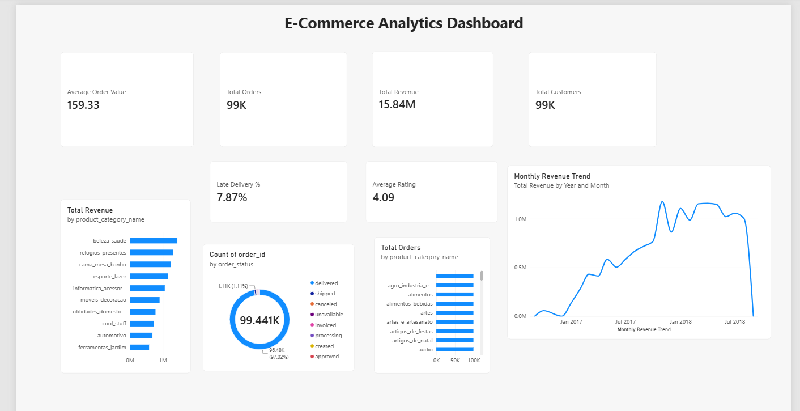

# E-Commerce Analytics System

An end-to-end data analytics project that explores e-commerce sales, customer activity, product performance, and delivery trends using SQL, Python, MySQL, and Power BI.

## About the Project

This project analyzes the **Brazilian E-Commerce Public Dataset by Olist** to understand the performance of an online marketplace across orders, revenue, product categories, customer reviews, payment methods, and delivery.

The goal is to transform raw e-commerce data into meaningful business insights that can support data-driven decision-making.

## Project Objectives

* Analyze sales and revenue trends.
* Understand customer purchasing patterns.
* Identify top-performing product categories.
* Explore order statuses and payment methods.
* Analyze customer ratings and reviews.
* Evaluate delivery performance and delays.
* Build an interactive Power BI dashboard to visualize key business metrics.

## Tools & Technologies

| Tool     | Purpose                                 |
| -------- | --------------------------------------- |
| SQL      | Business queries and data analysis      |
| MySQL    | Data storage and database management    |
| Python   | Data analysis and processing            |
| Pandas   | Data manipulation and analysis          |
| Power BI | Dashboard development and visualization |

## Dashboard Preview

The Power BI dashboard includes the following visualizations:

* Total Orders
* Total Revenue
* Average Order Value
* Total Customers
* Average Rating
* Late Delivery Percentage
* Monthly Revenue Trend
* Order Status Distribution
* Top 10 Product Categories by Revenue
* Top 10 Product Categories by Orders

## Key Metrics

The current dashboard displays the following results:

| Metric          |         Value |
| --------------- | ------------: |
| Total Orders    |        99,441 |
| Total Revenue   | 15.84 million |
| Total Customers |        99,441 |
| Average Rating  |          4.09 |

*Note: These are current dashboard outputs. Metric definitions and calculations should be validated against the underlying data before formal business reporting.*

## Project Files

| File                        | Description                       |
| --------------------------- | --------------------------------- |
| `01_data_loading.py`        | Python data-loading script        |
| `ecommerce_analysis.py`     | Python data analysis script       |
| `data_loading.sql`          | SQL data-loading script           |
| `business_analysis.sql`     | SQL queries for business analysis |
| `Project_Documentation.txt` | Project documentation             |
| `dashboard.png`             | Power BI dashboard preview        |

## Power BI Dashboard

**[View or Download the Power BI Dashboard (.pbix)](https://drive.google.com/file/d/18y_Za0Gcvp7hPYsQVfYekRECg_twLSpO/view?usp=drive_link)**

If prompted to request access, ensure the Google Drive file is shared with **Anyone with the link — Viewer**.

The `.pbix` file can be opened using Microsoft Power BI Desktop.

## Dataset

**Brazilian E-Commerce Public Dataset by Olist**

The dataset is publicly available on Kaggle and contains information about orders, customers, products, sellers, payments, reviews, and product categories.

The original dataset is not included in this repository.

## How to Explore the Project

1. Review the SQL files to understand the data-loading and business-analysis queries.
2. Explore the Python scripts to understand the data-processing and analysis workflow.
3. View `dashboard.png` to preview the Power BI dashboard.
4. Open or download the `.pbix` file using the Google Drive link above to explore the report in Power BI Desktop.

## Future Improvements

* Add customer segmentation and retention analysis.
* Improve data validation and cleaning.
* Introduce additional business performance indicators.
* Enhance dashboard interactivity.
* Explore automated reporting and business insight generation.

## Author

**Mahi Jha**
B.Tech — Computer Science and Business Systems
